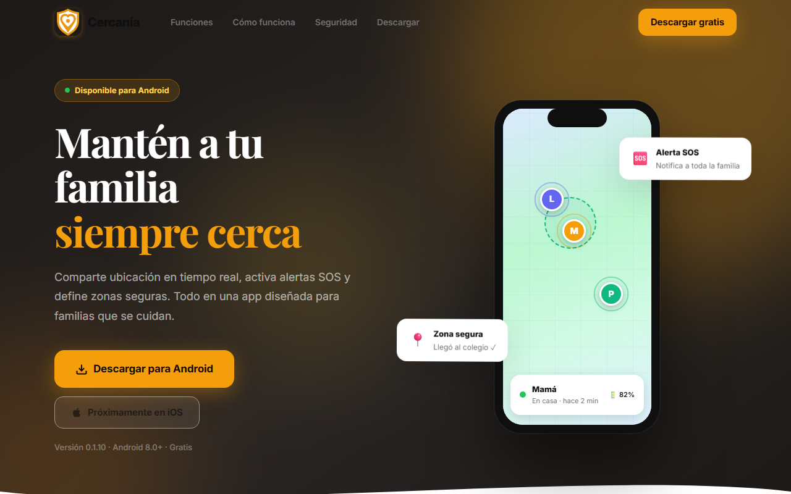

# 📍 Cercanía — Localización familiar en tiempo real

[](https://github.com/FernandoJose25/cercania/actions/workflows/ci.yml)


App móvil Android para que las familias compartan su ubicación en tiempo real, reciban alertas SOS y definan zonas seguras. Es una alternativa a Life360 pensada para Latinoamérica. Está publicada y en uso: **[landing y descarga](https://cercania.vercel.app)** · **[releases con APK](https://github.com/FernandoJose25/cercania/releases)**.

> **English summary:** Real-time family location sharing app (Life360-style) for Latin America. Built solo end-to-end: React Native/Expo client with background GPS and Kalman filtering, Supabase backend (Postgres + RLS + Realtime + RPC), push notifications, SOS alerts, geofences and a social account-recovery flow. Shipped as APK releases with an in-app update checker.



## Mi rol

Proyecto personal hecho **de punta a punta por mí**: producto, diseño de UI, app móvil, base de datos, seguridad, landing page y distribución (64 commits, 11 versiones publicadas).

## Qué hace

- **Mapa en vivo del grupo.** Los pines se mueven con animación suave a medida que llegan las posiciones por Supabase Realtime. Cada pin muestra batería y hace cuánto se actualizó.
- **Tracking en primer y segundo plano.** Con el mapa abierto actualiza cada ~1 s y en background cada ~3 min, con `expo-location` + `expo-task-manager`.
- **Filtro de Kalman propio** para suavizar el GPS y descartar lecturas imposibles (precisión > 25 m o velocidad > 200 km/h).
- **SOS.** Botón que se mantiene presionado 3 s, envía una notificación push urgente a todo el grupo, muestra un beacon animado en el mapa y permite grabar audio o video.
- **Zonas seguras (geofences)** con eventos de entrada y salida.
- **Privacidad.** Tiene modo invisible con expiración, modo viaje y ubicación compartida temporal, y deja un registro de quién vio tu ubicación.
- **Grupos familiares** con invitación por código (expira en 48 h) y chat grupal.
- **Historial de recorridos** de los últimos días, lugares frecuentes y resumen diario.
- **Autenticación.** Email con OTP, Google Sign-In, bloqueo biométrico (huella o Face ID) y sesión cifrada en `expo-secure-store`.
- **Recuperación social de cuenta.** Si pierdes el acceso, 3 contactos de confianza aprueban la recuperación y hay una espera de 48 h como protección antifraude.
- **Auto-actualización.** La app consulta `version.json` y ofrece descargar la nueva APK.

## Stack

| Capa | Tecnologías |
|---|---|
| App móvil | React Native, Expo SDK 51, Expo Router, TypeScript (strict), Zustand, TanStack Query |
| Mapas y ubicación | react-native-maps (Google Maps), expo-location, expo-task-manager, filtro de Kalman, Haversine |
| Backend | Supabase: PostgreSQL, Row Level Security, Realtime (WebSocket), Auth (JWT + OTP), funciones RPC en PL/pgSQL |
| Notificaciones | Expo Push + Firebase Cloud Messaging |
| Distribución | EAS Build (APK), GitHub Releases, landing estática en Vercel |

## Arquitectura

```
app-scaffold/          App Expo (≈12 500 líneas de TypeScript, 33 pantallas)
  app/(auth)/          Rutas públicas: bienvenida, login, registro, OTP, recuperación
  app/(app)/           Rutas protegidas: mapa, grupos, SOS, historial, ajustes
  src/services/        Lógica de negocio: tracking, sos, auth, notificaciones, actualizaciones…
  src/store/           Estado global con Zustand (auth, tracking, grupos)
  src/hooks/           useGroupLive (Realtime), useBatteryStatus, useSOSAlert…
  src/utils/kalman.ts  Filtro de Kalman para GPS
supabase/migrations/   Esquema SQL: 22 tablas con RLS y 35 funciones RPC
landing/               Landing page de descarga (HTML/CSS/JS, desplegada en Vercel)
docs/                  Guía interna de releases
```

**Flujo de una ubicación:** GPS → filtros de calidad → Kalman → RPC `update_location()` → Supabase Realtime → los pines se actualizan en el mapa de cada miembro del grupo.

**Seguridad:** RLS en todas las tablas (un usuario solo ve las ubicaciones de su grupo), RPC cerradas a quien no tiene sesión salvo las de recuperación, tokens en el llavero nativo, biometría opcional y HTTPS/WSS obligatorios.

## Correr el proyecto

Requisitos: Node 20+, un proyecto de Supabase y un dispositivo o emulador Android.

```bash
cd app-scaffold
cp .env.example .env        # completa la URL y la anon key de tu proyecto Supabase
npm install
npm run typecheck           # TypeScript sin errores
npx expo run:android        # build de desarrollo
```

Para la base de datos, ejecuta en orden los scripts de `supabase/migrations/` en el SQL Editor de tu proyecto.

## Estado

App en uso real. La versión publicada es la v0.1.9 y la v0.1.10 está en desarrollo. Lo próximo es la versión para iOS.
